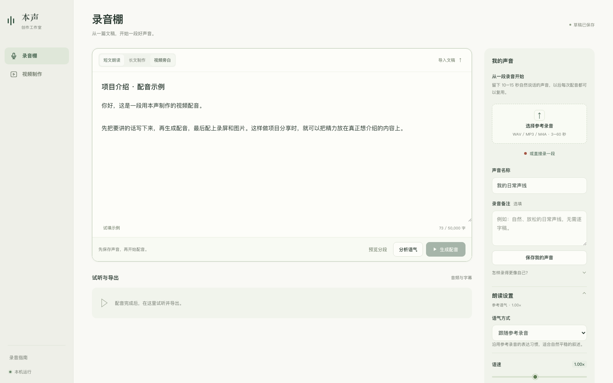

# 本声 · 私人录音棚

在自己的 Apple Silicon Mac 上，用参考录音生成中文、英文配音。适合项目介绍、功能演示、知识分享、长文朗读和视频旁白。安装好模型后，配音在本机生成，无需云端 TTS API Key。



## 从这里开始

- **第一次安装：** [详细安装与使用指南](docs/INSTALL.md)
- **模型太大，去哪里下载：** [模型地址、体积、目录与校验方法](docs/MODELS.md)
- **上游来源与许可：** [第三方组件说明](THIRD_PARTY_NOTICES.md)

当前支持 **macOS 14+ / Apple Silicon**，建议 16 GB 或以上内存。已在 M3 Pro / 18 GB 上使用和验证；Windows、Linux、Intel Mac 尚未完成本工作台适配。

## 快速安装

先安装 [uv](https://docs.astral.sh/uv/getting-started/installation/)；有 Homebrew 时可以运行 `brew install uv`。然后在终端执行：

```sh
git clone https://github.com/ToddZhaoXY/TTS_BenSheng.git
cd TTS_BenSheng
chmod +x 安装环境.command 启动录音棚.command
./安装环境.command
./启动录音棚.command
```

安装器会准备两套独立的 Python 环境、英文词典和默认 **IndexTTS-2.5** 模型。默认模型及辅助文件合计约 **8.29 GB**，首次下载需要网络，支持断点续传与完整性校验。建议预留 25 GB 磁盘空间，详细步骤和常见问题见 [INSTALL.md](docs/INSTALL.md)。

启动后访问 **<http://127.0.0.1:8765>**。保留启动终端；按 Control+C 停止服务。录音、文稿与作品保存在本机 `data/` 中。

## 能做什么

- **保存自己的声音**：导入或直接录制 10–15 秒自然人声，之后复用。
- **文字生成配音**：支持中文、英文，粘贴文字或导入 TXT / Markdown，按标点和段落拆分长文。
- **调整语气和语速**：IndexTTS 支持自动语气分析、手动情绪和逐段调整；也可以跟随参考录音。
- **试听与导出**：WAV、MP3、SRT 字幕和 ZIP 打包；中断后可继续已完成的任务。
- **简单的视频制作**：用背景图、滚动正文、配音和可选背景音乐，导出横屏或竖屏的 1080p MP4。
- **切换模型**：默认 IndexTTS-2.5；可另行下载 Qwen3-TTS 0.6B，作为速度优先的自然朗读选择。

## 做第一段视频配音

1. 在“我的声音”里选择参考录音，或者点击“直接录一段”，保存声线。
2. 选择“视频旁白”，粘贴两三句话。可以先使用 [配音示例](examples/配音示例.txt)。
3. 初次使用可选“跟随参考录音”，先试听再调整语速、情绪或文稿。
4. 点击“生成配音”，完成后下载音频，放进剪辑软件并配上录屏或图片。

只粘贴需要说出的正文：**Markdown 标题、时间说明、标记不会被自动删除，也可能被读出来。** 音色相似度、专业词、多音字和数字读法都需要试听确认。

一种方便的工作方法是：先自由录音 → 用外部工具转写、整理文稿 → 自己确认原意 → 用本声生成配音 → 按段准备画面。录音转写和 AI 改稿目前不内置在本声中。

## 模型下载

**模型不存放在 GitHub 仓库中。** 多个权重文件超过 GitHub 普通 Git 的 100 MiB 单文件限制；克隆本项目不会下载模型、个人录音或生成作品。

| 模型 | 用途 | 下载量 | 发布页面 |
|---|---|---:|---|
| IndexTTS-2.5 及必需辅助文件 | 默认；情绪分析与逐段控制 | 约 8.29 GB | [Hugging Face](https://huggingface.co/IndexTeam/IndexTTS-2.5) / [ModelScope](https://modelscope.cn/models/IndexTeam/IndexTTS-2.5) |
| Qwen3-TTS 0.6B MLX | 可选；自然朗读，速度优先 | 约 2.51 GB | [Hugging Face](https://huggingface.co/mlx-community/Qwen3-TTS-12Hz-0.6B-Base-bf16) |

安装器自动准备默认模型。环境安装完成后，可以单独下载 Qwen：

```sh
.venv/bin/python scripts/download_model.py
```

再到“模型与服务”中切换。模型的辅助文件、手动放置目录、校验命令与版本信息见 [MODELS.md](docs/MODELS.md)。

## 输出与实际边界

- WAV：48 kHz / 24 bit PCM；MP3：192 kbps。IndexTTS 源音频为 22.05 kHz，升采样用于剪辑兼容，不增加源音频细节。
- SRT 依据各段实际生成的音频时长，**不是逐字强制对齐**。
- 单次最多 50,000 字，建议长内容按章节或用途拆分；本地生成速度取决于硬件和文稿，不保证实时。
- 自动语气分析是 8 类情绪分类，不是理解整部作品的通用导演模型；复杂语气需要人工调整。
- 内置视频制作主要是固定背景与全文滚动，文字按总时长匀速移动；项目操作演示仍建议配合剪辑软件。
- 当前服务只监听本机地址，未设计为带有多用户登录与权限的公网服务。

## 文件位置与开发检查

```text
studio/                 网页后端、TTS 调度、音频与视频处理
web/                    本地工作台界面
scripts/                模型下载、环境检查与验证工具
index-tts-main/          固定版本的上游源码（不含权重）
index-tts-main/checkpoints/  本机下载的 IndexTTS 权重，不提交 Git
models/                 可选 Qwen 权重，不提交 Git
data/                   声音与生成作品，不提交 Git
docs/                   安装与模型说明
```

```sh
.venv/bin/python -m pytest -q
.venv/bin/python scripts/download_index25.py --verify-only
.venv-index/bin/python scripts/prepare_language_resources.py --verify-only
```

使用的上游源码快照和原始许可证保留在 `index-tts-main/`。本声是独立工作台，非上游官方产品；IndexTTS 使用自定义许可，Qwen 和辅助模型各有对应条款，详见 [THIRD_PARTY_NOTICES.md](THIRD_PARTY_NOTICES.md)。
